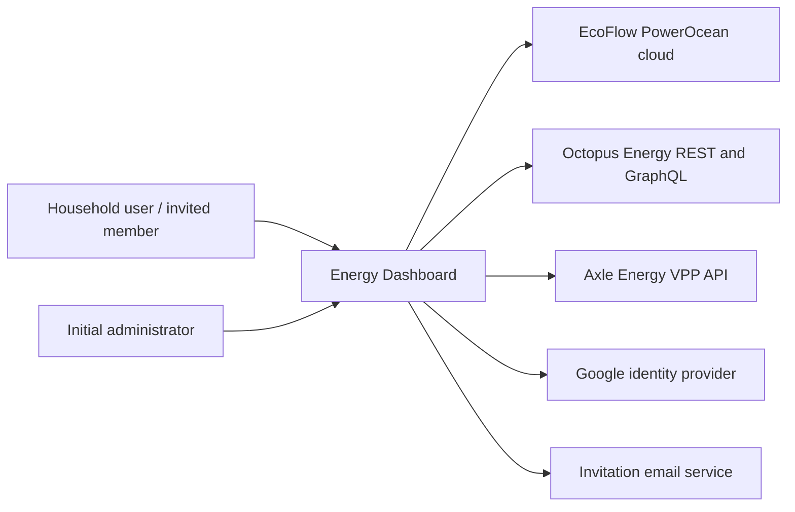
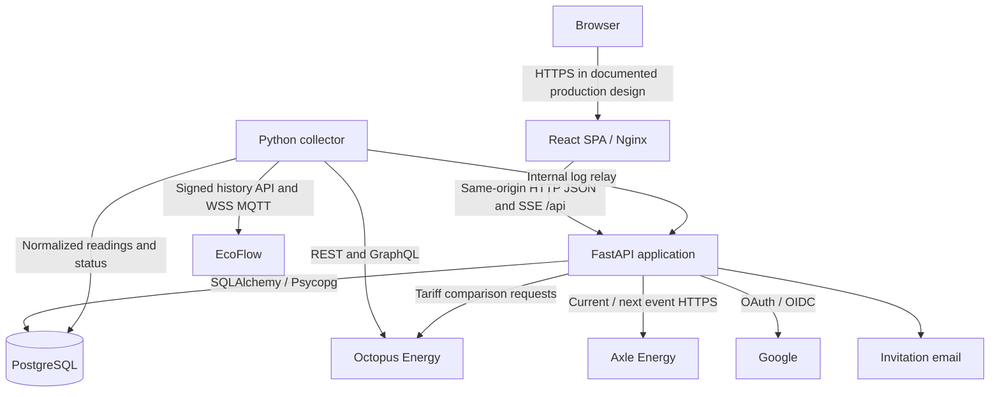
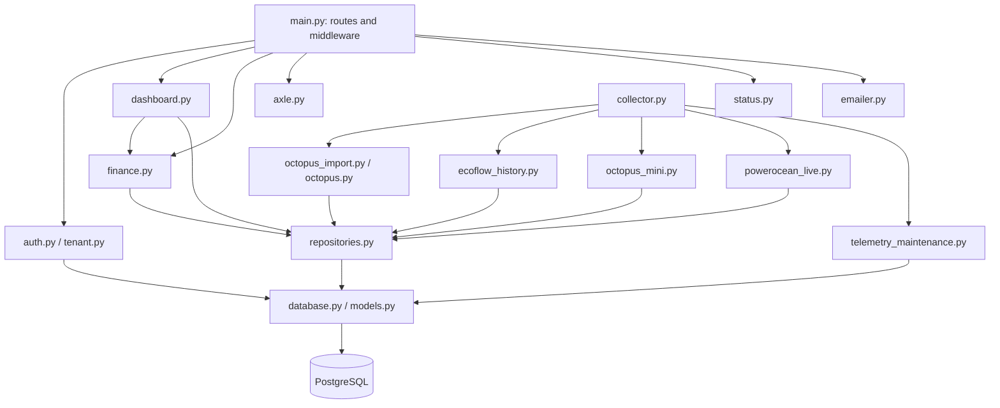
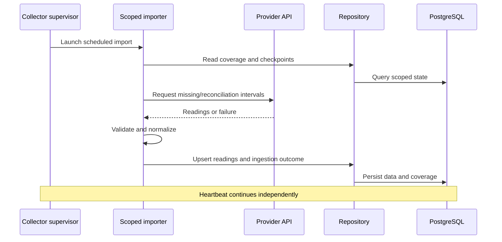
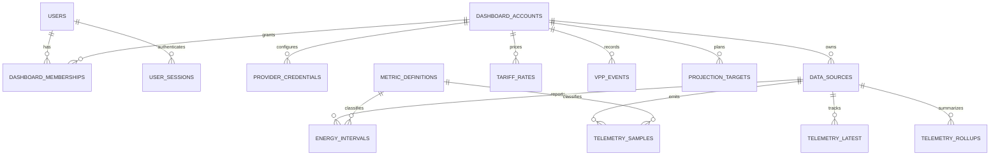
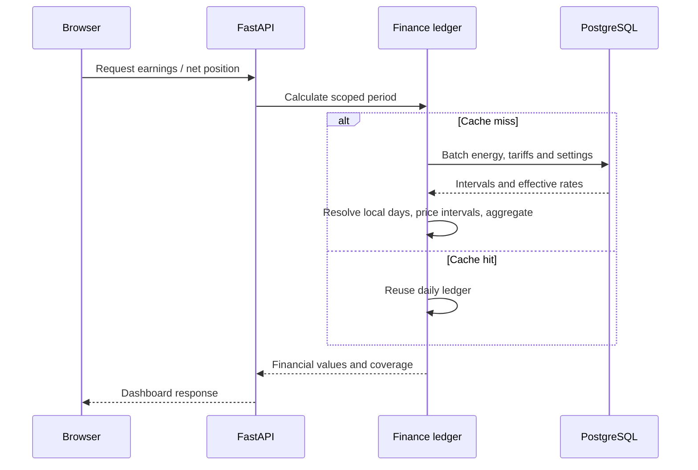
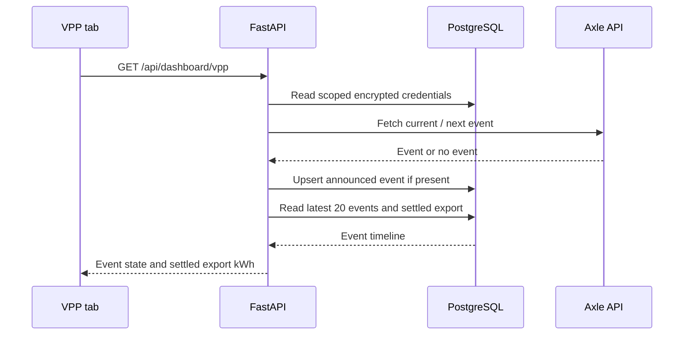
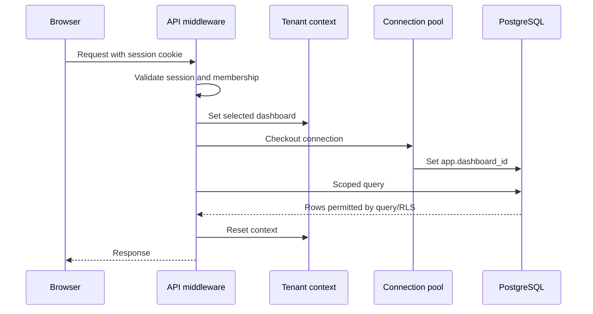
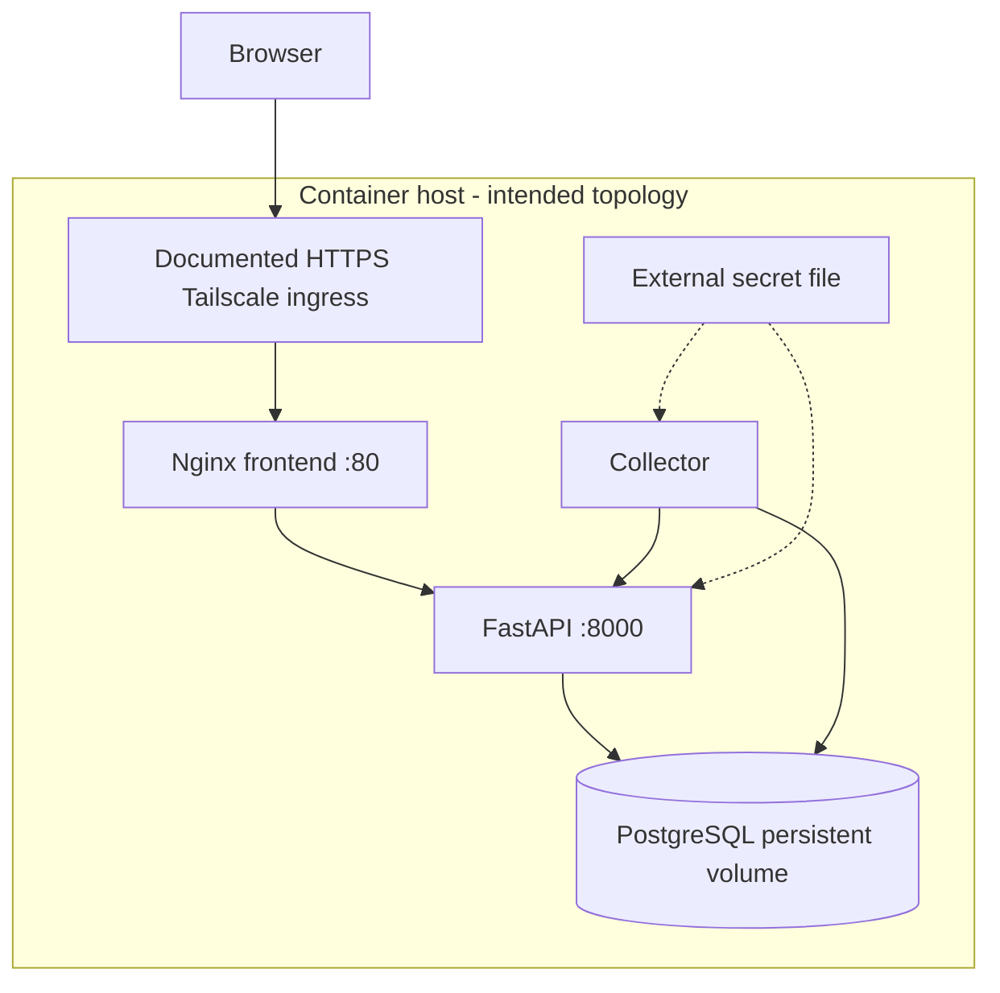

# Energy Dashboard — Software Architecture Document

**Status:** Current-state baseline (static source review)  
**Application version:** 0.1.0  
**Source revision:** `759ba86bd82dcf16b1d09b84ca09cdee1bf304b8`  
**Scope:** Uploaded `energy-dashboard-legacy.zip`, reviewed 26 November 2026  
**Development approach:** Created using OpenAI Codex (project owner statement)

## 1. Purpose and scope

The dashboard consolidates residential EcoFlow PowerOcean solar PV and battery data, Octopus Energy electricity and gas settlement/tariff data, and Axle Energy virtual power plant (VPP) events. It supports live monitoring, historical analysis, financial estimates, tariff comparisons, projections, CSV export and invited access to household dashboards.

This document describes the implemented architecture, not a proposed rewrite. Recommendations are explicitly separated from observed implementation. Source paths below are relative to `source/` unless otherwise stated. No running deployment, provider account or database was accessed; tests were inspected but not executed.

## 2. Architecture drivers

| Driver | Architectural response |
|---|---|
| Financial accuracy | Separate settlement data from device telemetry; date-effective tariff pricing; decimal arithmetic |
| Provider delays and outages | Background ingestion, coverage tracking, reconciliation and retries |
| Responsive dashboard | Separate API and collector processes, indexed queries, short-lived finance cache |
| Household isolation | Dashboard memberships, request context, scoped database queries and row-level security (RLS) |
| Credential protection | Server-side provider access, encrypted stored credentials, secure sessions |
| Storage growth | Daily telemetry partitions, retention and minute/hour rollups |
| Maintainability | Provider-specific adapters, repository layer, migrations and locked dependencies |

These are inferred design drivers, not agreed SLAs or formal requirements. No quantified availability, latency or recovery objectives were supplied.

## 3. C4 Level 1 — System context

The application is an analytics and monitoring system. The reviewed PowerOcean connection is listen-only; tariff comparison models hypothetical dispatch rather than issuing battery control commands. Axle integration records announced events and associated settled export, not verified reward payments.

## 4. C4 Level 2 — Container architecture

The backend is a modular monolith with a separate collector runtime sharing the same codebase and relational database. The collector is not an independently owned microservice with its own database. There is no message broker or distributed cache in the supplied source.

| Container | Technology | Responsibility |
|---|---|---|
| Frontend | React 19, TypeScript 5.9, Vite 7, Tailwind 4, ECharts 6, Lucide | Dashboard views, access/setup UI, charts, status and API calls |
| API | Python 3.13, FastAPI, Uvicorn | Authentication, queries, financial calculations, settings, VPP and exports |
| Collector | Python, aiohttp, Paho MQTT | Historical imports, live workers, reconciliation, heartbeat and retention |
| Database | PostgreSQL 17 (documented), SQLAlchemy 2, Psycopg 3, Alembic | Normalized data, account state, tariffs and telemetry |
| Production web server | Nginx 1.28 Alpine | Static SPA and reverse proxy to API |

Evidence: `backend/pyproject.toml`, `frontend/package.json`, Dockerfiles, `frontend/nginx.production.conf`, `README.md`.

## 5. C4 Level 3 — Backend components

The diagram groups logical responsibilities; it is not an exhaustive Python import graph.

| Module | Responsibility |
|---|---|
| `main.py` | HTTP routes, session middleware, setup, tariff simulation, CSV and Axle event persistence |
| `auth.py`, `tenant.py` | Google login, invitations/session identity, AES-GCM credentials and context-local dashboard scope |
| `dashboard.py`, `finance.py` | Read models, financial ledger, aggregation, projections and pricing |
| `repositories.py`, `catalog.py`, `models.py` | Persistence, validation, canonical metrics and schema mapping |
| `collector.py` | Worker supervision, scheduling, heartbeat and log relay |
| `octopus.py`, `octopus_import.py` | Provider access, meter discovery, tariff and settlement ingestion |
| `ecoflow_history.py`, `ecoflow_clientid.py`, `powerocean_live.py` | Signed history access, client identity and live MQTT decoding |
| `octopus_mini.py` | Smart-meter telemetry ingestion |
| `axle.py` | Current/next VPP event client and response validation |
| `status.py`, `telemetry_maintenance.py`, `emailer.py` | Health, rollups/retention and invitation email |

### Frontend

`App.tsx` owns the main dashboard and views (overview, history, earnings, net position, bills, tariff comparison, VPP, system and operations). `Access.tsx` handles access and setup interfaces; `useStatus.ts` handles status streaming. The SPA uses the same origin for API calls through Vite in development and Nginx in production. Large files indicate opportunities for feature-level decomposition.

## 6. Integration and ingestion architecture

| Provider | Interface | Data / semantics |
|---|---|---|
| EcoFlow history | Signed Developer API quota history | Directional energy; reported device values, not settlement |
| EcoFlow live | Enhanced Mode WSS MQTT | Solar, grid, home, battery, SOC and system state; listen-only |
| Octopus REST | Account, consumption and tariff endpoints | Electricity import/export and gas settlement; rates and standing charges |
| Octopus Mini | GraphQL | Low-latency telemetry, not billing authority |
| Axle | Bearer-authenticated `/vpp/home-assistant/event` | Current/next event, time range, direction and update time |
| Google | OAuth/OIDC | Invited user identity |

### Collector lifecycle

The collector writes a heartbeat on a nominal ten-second loop, schedules telemetry maintenance hourly, refreshes live-worker configuration every 60 seconds and reconciles workers on each heartbeat. Historical import launch checks are scheduled every five minutes, with EcoFlow and Octopus history workers prevented from running concurrently by the supervisor. Importer-level coverage and reconciliation determine actual provider requests; the five-minute check is not a full backfill every five minutes. Mini polling is 120 seconds in the current collector source (the older README says ten seconds). EcoFlow live workers are per-dashboard and restarted when credentials change or workers exit.

Provider settlement delays are expected. Missing historical data is represented as missing/partial, not silently zero. The internal README documents 14-day reconciliation and earliest-agreement/start-month backfill rules; verify those operational settings against the importers before changing them. EcoFlow live connection freshness and decoded snapshot behavior are documented as 35 seconds and ten seconds respectively.

## 7. Data architecture

Logical ER view; consult migrations for exact constraints and additional ingestion, invitation and health tables. Expected schema revision is `0018_axle_credential_provider` (`database.py`).

| Data group | Tables / purpose |
|---|---|
| Identity | users, sessions, invitations, memberships, dashboard accounts |
| Configuration | provider_credentials, projection_targets |
| Historical | data_sources, metric definitions, energy_intervals, tariff_rates |
| Live | telemetry_samples, telemetry_latest, telemetry_rollups, provider health |
| Ingestion | ingestion_runs, coverage_windows, sync_checkpoints |
| VPP | vpp_events, uniquely identified by dashboard/provider/start/end |

### Canonical data rules

- UTC timezone-aware timestamps; half-open intervals `[start,end)`; Europe/London calendar boundaries account for DST.
- Directional energy in non-negative kWh; power in W; battery SOC in percent. Tariff rates in pence, including zero and negative rates.
- Quality: settled, reported, derived or estimated. Completeness: complete or partial. An explicit zero differs from absent data.
- Octopus import/export settlement is authoritative for corresponding grid energy. EcoFlow and Mini are independent comparison/telemetry sources.
- Raw telemetry partitioned by UTC day, retained for 30 days; minute/hour rollups retained indefinitely. Maintenance creates partitions ahead and verifies rollup coverage before deletion; advisory locking protects maintenance.
- Coverage windows and actual readings, not checkpoints alone, establish historical completeness.

Evidence: `docs/data-schema.md`, `models.py`, `repositories.py`, migrations 0002–0018. The schema document predates multi-tenancy; current migrations extend its original household model.

## 8. Financial architecture

Financial values are derived at query time from normalized energy and date-effective rates. The finance module batches reads, builds a daily ledger and caches results for 15 seconds per dashboard/range; settings changes invalidate the cache. Decimal arithmetic avoids binary floating-point money errors. Intervals spanning tariff changes are apportioned by duration. Hourly EcoFlow data takes precedence over daily aggregates to prevent double counting.

| Measure | Meaning |
|---|---|
| Import cost | Imported energy multiplied by applicable import rates |
| Export credit | Exported energy multiplied by applicable export rates |
| Standing charges | Date-effective daily electricity/gas charges where available |
| Net position | Import/gas costs and standing charges compared with export credit; source and period matter |
| Solar/battery savings | Calculated valuation of device energy flows; not an official provider reward |
| Tariff comparison | Alternative tariff pricing and optional hypothetical evening battery dispatch |

The internal README distinguishes live daily EcoFlow-based net position from longer-period Octopus settlement-based totals. The earnings calendar and overview use different configured/settled inputs depending on the view. Do not assume all displayed earnings share one definition. Available priced readings can contribute to partial totals; periods without settled data remain unknown in settlement calendar calculations.

**Known historical discrepancy:** `docs/earnings-audit-2026-09.md` records £105.09 dashboard calculated savings versus £95.15 EcoFlow app savings for 1–28 September 2026. The audit attributes the difference to energy-flow semantics and missing battery-charge provenance/reported savings. This is a historical audit, not a newly reproduced test. Savings should be labelled estimates unless independently reconciled.

### Axle VPP event flow

Current implementation is request-driven, not an independent Axle history collector. Only settled Octopus export intervals wholly inside event boundaries are summed; no matching intervals are returned as zero. This can undercount boundary-overlapping intervals and obscure pending settlement. The reviewed endpoint does not ingest Axle payout amounts or calculate event-specific monetary rewards. A future earnings feature must distinguish ordinary export credit, estimated flexibility reward and confirmed payout. Events may be missed if no VPP request occurs while they are announced.

## 9. API architecture

| Endpoint group | Examples |
|---|---|
| Health/status | `/api/health/live`, `/api/health/ready`, `/api/status`, `/api/events` (SSE) |
| Identity | `/api/auth/me`, `/api/auth/google`, `/api/auth/google/callback`, `/api/auth/dashboard`, `/api/auth/logout` |
| Administration/setup | `/api/admin/invitations`, `/api/setup` |
| Analytics | `/api/dashboard/overview`, `/api/dashboard/history`, `/api/dashboard/rates`, `/api/dashboard/daily-earnings`, `/api/dashboard/daily-net-position`, `/api/dashboard/energy-bills` |
| Simulation | `/api/dashboard/tariff-comparison/defaults`, `/api/dashboard/tariff-comparison` |
| VPP/live/export | `/api/dashboard/vpp`, `/api/telemetry/live`, `/api/exports/energy.csv` |
| Operations | `/api/operations`, `/api/operations/retry-partials`, `/api/collector-logs`, internal collector-log route |

FastAPI provides OpenAPI documentation. SSE conveys status snapshots; it is not a durable event bus. Review `main.py` for exact methods, parameters and access rules. Some read endpoints have hard-coded default date ranges; make defaults dynamic or require explicit dates in a future revision.

## 10. Security and tenant isolation

Google sign-in is invite-only. The configured initial administrator manages invitations; users may belong to multiple dashboards and select an authorized dashboard. Session tokens are random and stored hashed; session lifetime is 14 days. Cookies use Secure, HttpOnly for session/state, and SameSite=Lax; the CSRF cookie is readable by the client for mutation protection. OAuth state is checked against the cookie. Provider credentials use AES-GCM with dashboard/provider associated data and an external encryption key.

RLS is explicitly enabled and forced for sources and tariffs in migration 0010; VPP events have a policy in migration 0017. The connection checkout hook resets dashboard scope. Do not assume every table or database role has equivalent RLS protection: verify policies, ownership and bypass privileges using production-equivalent roles. Explicit membership checks and scoped joins remain important.

Threats to validate: cross-tenant access via pooled connections and exports; session theft/CSRF; key rotation and encrypted backup recovery; provider credentials in logs; authorization of operations/internal routes; OAuth redirect configuration. No penetration test or secret scan was performed. Keep secrets outside Git and Docker build contexts. The older README's collector-only credential description is not universal: API code decrypts Axle credentials and supports provider settings/tariff comparison.

## 11. Deployment architecture

The source includes development and production frontend Dockerfiles, a Python backend Dockerfile, Nginx proxy configuration and setup/verification scripts. The internal README describes Docker Compose, loopback development ports 5173/8000, a PostgreSQL named volume and HTTPS Tailscale production access. **Neither development nor production Compose manifests, environment examples or actual host configuration are present in the supplied archive.** Consequently the diagram is a documented intended topology, not a verified deployment. The backend Dockerfile starts Uvicorn; the README describes migrations before API startup, but orchestration of that step is not verifiable here.

Production packaging should restore manifests without secrets, define migration ordering, readiness checks, persistent volumes, network boundaries and backup/restore procedures. Validate SSE proxy buffering/timeouts, TLS forwarding and secure-cookie behavior. Do not publish the database or internal collector route directly. Pin image digests for reproducibility.

## 12. Reliability and observability

- Liveness indicates API responsiveness; readiness checks database access and expected migration revision.
- Collector heartbeat and provider ingestion/connection status expose stale, failed and partial states.
- Background workers isolate live telemetry from historical import latency; the supervisor restarts dead live workers.
- Status SSE and browser reconnection logic support recovery from interrupted streams.
- Collector logs are relayed to API; validate bounded storage, access controls and redaction.
- Database pool is configured with five pooled connections, two overflow connections and three-second pool/connect timeouts per engine (`database.py`).
- No external metrics platform, alerting, distributed tracing, backup schedule or recovery SLA was verified.

## 13. Testing and quality strategy

The archive contains pytest suites covering finance, energy schema/export, Octopus imports/Mini, EcoFlow history/live, invitations, settings access and status. `frontend/package.json` defines TypeScript checking and production build. `scripts/verify_stack.py` is documented as a destructive-to-availability local integration check that cycles services; run only against a disposable or approved environment. `backend/scripts/benchmark_finance.py` supports finance handler benchmarks.

Recommended acceptance gates: backend tests against PostgreSQL, frontend typecheck/build, cross-tenant isolation with real database roles, DST/tariff boundary tests, provider outage/replay tests, migration from prior schema and backup restoration. Add Axle event boundary, missing settlement, deduplication and payout tests. No test results or performance measurements are asserted here.

## 14. Retrospective architecture decisions

These are inferred ADR summaries, not historical records of stakeholder approval.

| ID | Observed decision | Benefit | Trade-off |
|---|---|---|---|
| ADR-001 | Modular backend plus collector | Simple deployment and shared domain logic | Shared DB and release coupling |
| ADR-002 | PostgreSQL normalized interval model | Consistent cross-provider analytics | Schema and query complexity |
| ADR-003 | Settlement authority separated from telemetry | Financial traceability | Delayed authoritative results |
| ADR-004 | Query-time finance ledger and short cache | Repricing and responsive views | Cache consistency and query cost |
| ADR-005 | Dashboard-scoped access and encrypted credentials | Multi-household support | Key lifecycle and isolation complexity |
| ADR-006 | Raw retention with rollups | Bounded raw storage | Historical detail loss after retention |
| ADR-007 | Request-driven Axle fetch | Minimal background infrastructure | Potential missed events and incomplete reward history |

## 15. Technical debt and modernisation roadmap

Priorities are recommendations based on static inspection, not confirmed production incidents.

| Priority | Finding / risk | Proposed action |
|---|---|---|
| P0 | Deployment manifests missing from archive | Restore reproducible sanitized Compose definitions; verify migrations and restore |
| P0 | Multi-tenant isolation depends on roles and policies | Test all endpoints, pooled connections and RLS using non-superuser roles |
| P1 | VPP event history depends on page visits; no payout ingestion | Add scheduled Axle collection and explicit reward/settlement model |
| P1 | Event export uses fully contained intervals and zero fallback | Define overlap allocation and distinguish pending/missing/zero |
| P1 | Financial estimates differ from provider app | Define versioned calculation semantics, provenance and reconciliation tests |
| P1 | Large `main.py`, `dashboard.py`, `App.tsx` | Extract feature routers/services and frontend feature modules incrementally |
| P1 | Documentation drift | Update README to current auth, Mini cadence, import scheduling and deployment |
| P2 | Process-local cache and worker supervision | Measure before scaling; add distributed coordination only if required |
| P2 | Operational visibility and recovery not verified | Add metrics, alerting, retention monitoring and restore drills |

### Target direction

Retain the modular monolith and PostgreSQL initially. Establish domain boundaries for identity, ingestion, energy data, finance, VPP and operations. Keep provider adapters behind explicit contracts; make finance calculations deterministic and independently testable. Separate API routers from application services and persistence. Introduce durable job coordination only when workload or multi-instance deployment justifies it. Avoid a microservices rewrite without measured scaling or organizational drivers.

## 16. Evidence and limitations

Primary evidence: `backend/app/`, `backend/migrations/versions/`, `backend/tests/`, `frontend/src/`, dependency manifests, Dockerfiles and Nginx configuration. Supporting documentation: `README.md`, `docs/data-schema.md`, `docs/earnings-audit-2026-09.md`. The source README contains older scaffold statements contradicted by newer code (authentication, live integrations and scheduling); current code takes precedence. No live credentials, production infrastructure, actual provider responses or Git history beyond the archive revision were inspected. Mermaid diagrams are authored logical views and have not been rendered/tested in GitHub. This document is intended for repository-root `docs/ARCHITECTURE.md`; adjust location if documentation is kept under `source/docs/` instead.
