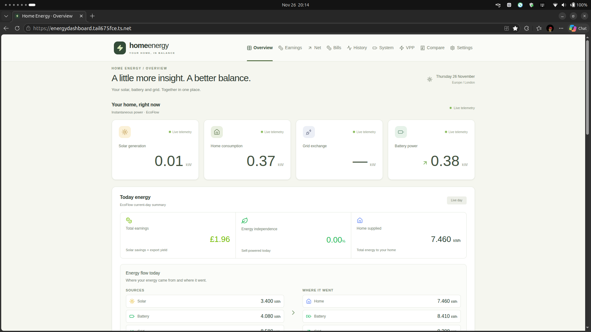
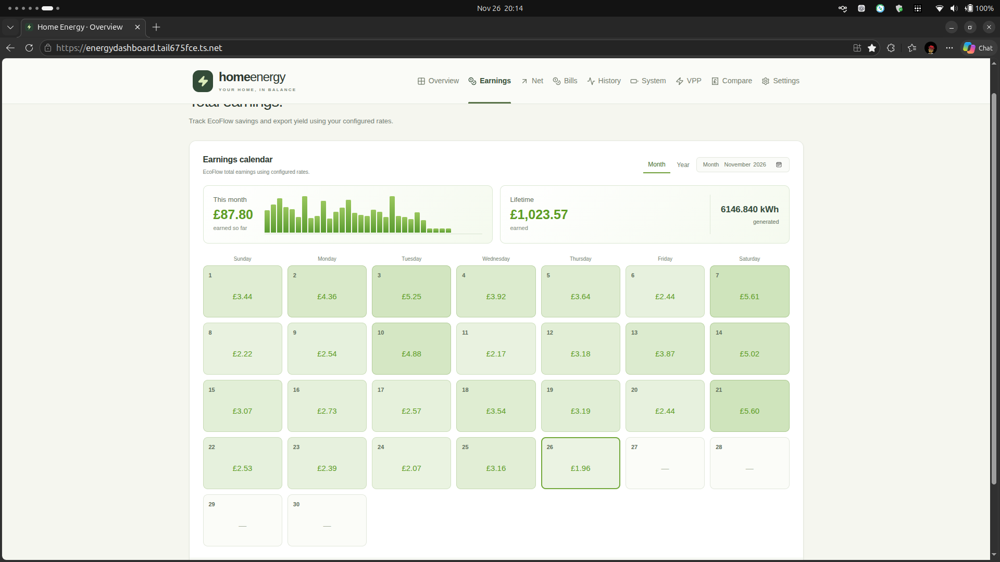
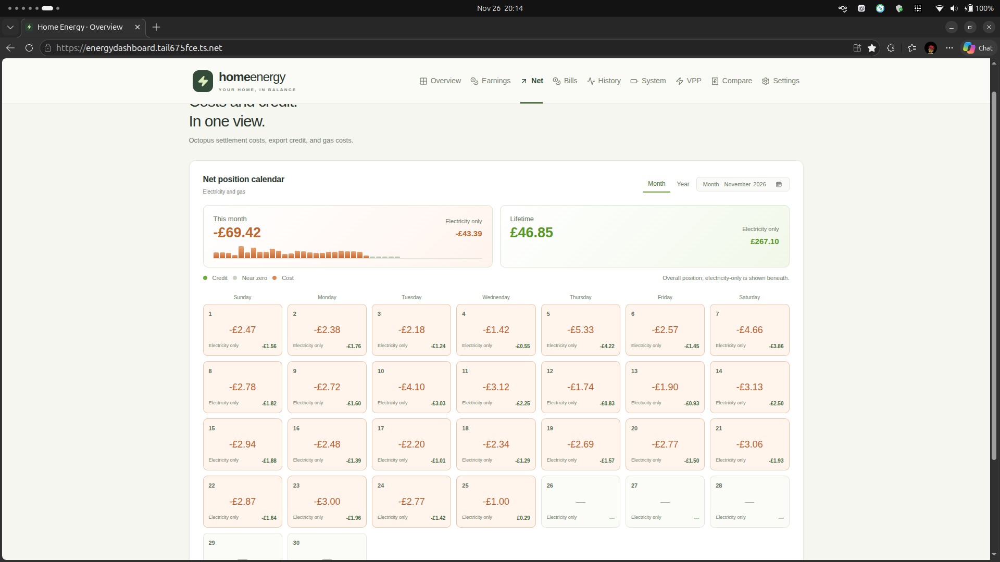
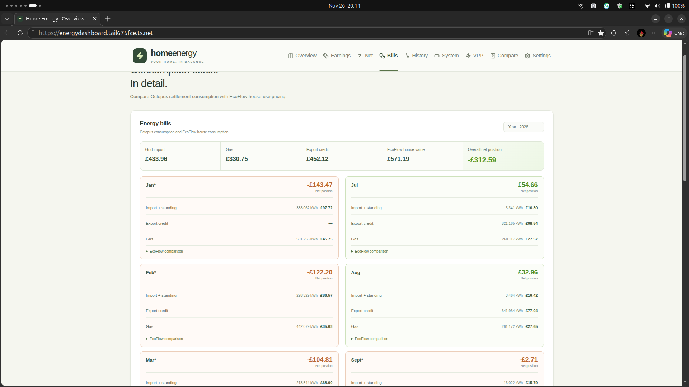
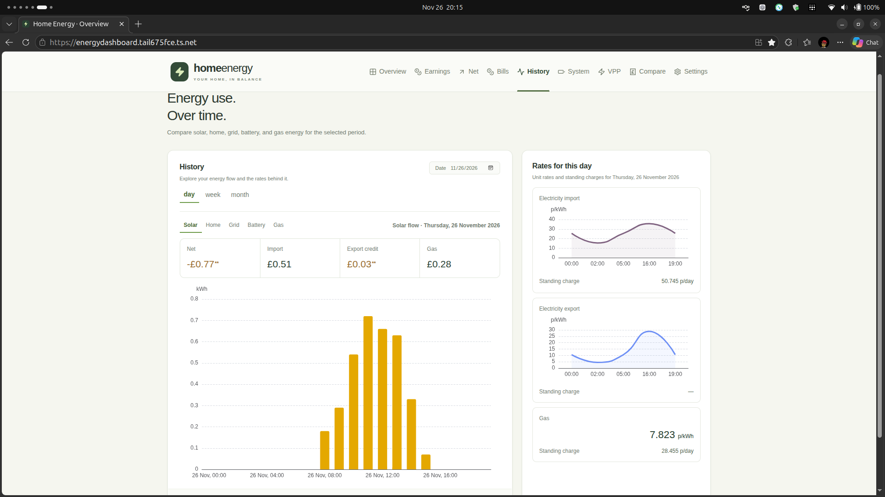
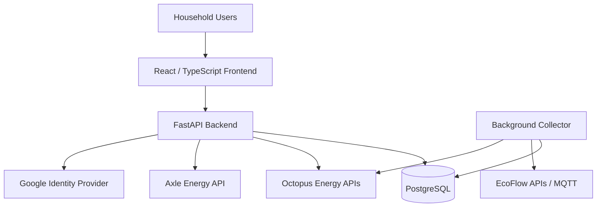
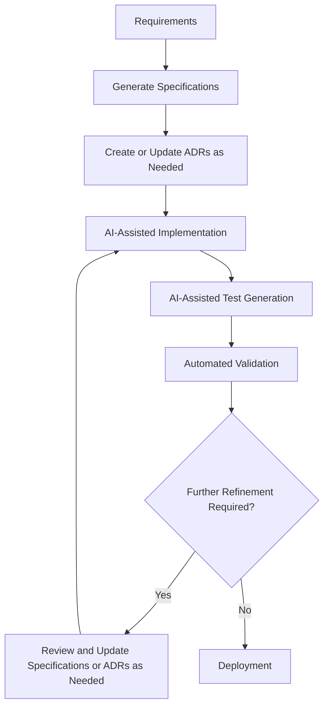
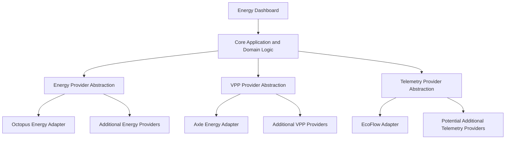
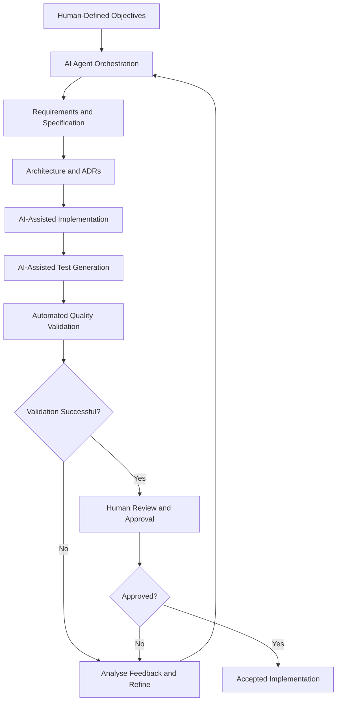

# Energy Dashboard – Legacy

A personal energy monitoring and analytics application designed to provide insights into the performance, energy consumption and financial benefits of a residential EcoFlow solar PV and battery storage system.

Developed using **OpenAI Codex** through a specification-driven, iterative software engineering approach, combining human-directed engineering, AI-assisted implementation, architectural decision-making and automated testing.

## Overview

The Energy Dashboard brings together data from multiple energy platforms into a single interface, providing a consolidated view of household energy generation, consumption, costs, savings and earnings.

The project aims to help homeowners better understand their energy usage, maximise solar self-consumption, optimise battery utilisation and evaluate the financial benefits of renewable energy.

It also serves as a practical exploration of AI-assisted software engineering, application architecture and the integration of heterogeneous third-party services.

## Live Application

**Application URL:** [Home Energy Dashboard](https://energydashboard.tail675fce.ts.net)

The existing version is deployed and operational, providing real-time energy monitoring, historical analytics and financial insights using residential energy data.

Access may be restricted to authorised users due to the private nature of household energy data.


## Application Screenshots

### Live Energy Overview

Real-time solar generation, household consumption, grid exchange, battery performance, daily earnings and energy flow.



<details>
<summary><strong>View additional application screenshots</strong></summary>

### Earnings Calendar

Daily, monthly and lifetime energy savings and export earnings, presented through an interactive calendar and aggregated financial summaries.



### Net Financial Position

Consolidated electricity and gas costs, export credits and overall financial performance, with daily, monthly and lifetime summaries.



### Energy Bills

Monthly and annual energy costs, settlement consumption, standing charges, export credits and comparisons against EcoFlow consumption data.



### Historical Analytics and Tariffs

Historical energy consumption and generation alongside time-dependent electricity import and export tariffs, gas rates and standing charges.




</details>

All screenshots are captured from the existing deployed application rather than design mock-ups or prototypes.

## Why "Legacy"?

This repository represents the existing deployed version of the Energy Dashboard and serves as an architectural and functional baseline for a planned next-generation implementation.

A new version is planned with two primary objectives:

- **AI Agent-Driven Software Engineering** – Gain practical experience in using AI agents to recreate and evolve an existing application, building upon the specification-driven development approach used in the original implementation.
- **Provider-Independent Architecture** – Address the existing tight coupling with Octopus Energy and Axle Energy by introducing clearer abstraction boundaries and a more extensible integration architecture, making it easier to incorporate additional energy suppliers and Virtual Power Plant (VPP) providers.

The planned iteration aims to improve architectural flexibility, maintainability, testability and extensibility while providing a practical environment for experimenting with AI agent-driven software development workflows.

The legacy implementation will serve as a reference for existing functionality, business rules, integration behaviour and architectural decisions throughout this evolution.

The term "legacy" identifies this version as the baseline for the planned architectural evolution, rather than implying that the application is obsolete or no longer operational.

## Key Features

- **Solar PV Monitoring** – Monitor solar energy generation and system performance.
- **Battery Monitoring** – Track battery storage, charging and discharging activity.
- **Real-Time Energy Monitoring** – Monitor live solar generation, household consumption, grid exchange and battery power.
- **Energy Consumption** – Understand household energy usage, grid imports and exports.
- **Historical Analytics** – Analyse energy generation and consumption across daily, weekly and monthly periods.
- **Energy Cost Analysis** – Calculate electricity and gas costs using data from Octopus Energy.
- **Savings Analysis** – Evaluate financial savings achieved through solar generation and battery storage.
- **Earnings Calendar** – Visualise daily, monthly and lifetime energy savings and export earnings.
- **Net Financial Position** – Consolidate energy costs and export credits to evaluate overall financial performance.
- **Energy Bills** – Analyse monthly and annual electricity and gas consumption costs, standing charges and export credits.
- **Tariff Comparison** – Analyse alternative energy tariffs and model potential financial outcomes.
- **Axle Energy Integration** – Monitor energy flexibility events and associated export activity.
- **Consolidated Dashboard** – Bring together energy and financial information from multiple providers.
- **Multi-User Access** – Support invited users and household dashboard access.

## Integrations

| Platform | Purpose |
|---|---|
| EcoFlow | Solar PV and battery storage system monitoring |
| Octopus Energy | Electricity and gas consumption, tariff data, costs and savings analysis |
| Axle Energy | Virtual Power Plant (VPP) events and energy flexibility monitoring |
| Google Identity | OAuth 2.0 / OpenID Connect authentication |

## Technology Stack

| Component | Technology |
|---|---|
| Backend | Python 3.13, FastAPI |
| Frontend | React 19, TypeScript, Vite |
| UI and Visualisation | Tailwind CSS, ECharts, Lucide |
| Database | PostgreSQL |
| Data Access | SQLAlchemy, Psycopg |
| Database Migrations | Alembic |
| External Integrations | REST APIs, GraphQL, MQTT |
| Real-Time Communication | MQTT, Server-Sent Events |
| Background Processing | Python, aiohttp, Paho MQTT |
| Authentication | Google OAuth 2.0 / OpenID Connect |
| Credential Encryption | AES-GCM |
| Automated Testing | Pytest, FastAPI TestClient |
| Containerisation | Docker |
| Web Server and Reverse Proxy | Nginx |
| AI-Assisted Development | OpenAI Codex |

## Project Objectives

- Improve visibility into household energy generation and consumption.
- Understand the financial return of solar PV and battery storage.
- Identify opportunities to optimise energy usage and reduce electricity costs.
- Track energy flexibility events and associated financial opportunities.
- Provide a unified view of energy performance across multiple platforms.
- Explore the practical application of AI-assisted software engineering to real-world requirements.

## Software Architecture

The application follows a modular monolithic architecture with a separate background collector process responsible for data ingestion, historical reconciliation and real-time telemetry collection.

The frontend and backend communicate through HTTP APIs and Server-Sent Events, while the API and background collector share a PostgreSQL persistence layer.

### High-Level Architecture



### Architectural Characteristics

- Separation of frontend, API, background processing and persistence responsibilities.
- Provider-specific integrations and data normalisation.
- Background data ingestion and historical reconciliation.
- Real-time telemetry processing.
- Multi-tenant dashboard access and data isolation.
- Authentication and encrypted provider credentials.
- Database schema management through versioned migrations.
- Telemetry retention and aggregation.
- Automated testing of business logic and application behaviour.
- Containerised application components.

Further details, including C4 architecture diagrams, component responsibilities, integration flows, data architecture, security considerations and architectural improvement opportunities, are available in the [Software Architecture Document](ARCHITECTURE.md).

## AI-Assisted Development Approach

This project was developed using **OpenAI Codex** through a specification-driven, iterative software engineering approach.

The development process combines human-directed engineering with AI-assisted implementation and automated testing.

Rather than relying solely on ad hoc prompts, technical specifications and Architectural Decision Records (ADRs) provide structured context to guide implementation and subsequent development iterations.

### Development Workflow

1. **Specification-First Development**

   Generate functional and technical specifications before implementation, establishing requirements, expected behaviour and development objectives.

2. **Architectural Decision Records (ADRs)**

   Create ADRs where appropriate to capture significant architectural decisions, technical considerations and the rationale behind implementation choices.

3. **AI-Assisted Implementation**

   Use the specifications and relevant ADRs as context for Codex to implement features, address technical challenges and iterate on existing functionality.

4. **Automated Validation**

   Generate automated tests using AI and use these tests to validate implementation changes, business logic and expected application behaviour.

5. **Continuous Refinement**

   Update specifications and ADRs as requirements evolve, architectural decisions change or additional technical considerations emerge. The updated documentation then provides context for subsequent AI-assisted development iterations.

### Development Lifecycle



### Engineering Principles

The development approach is guided by the following principles:

- Specifications provide structured context for AI-assisted implementation.
- Architectural decisions are documented where appropriate.
- AI-assisted development is iterative and guided by evolving requirements.
- Automated tests provide a mechanism for validating implementation changes.
- Specifications, architectural decisions and implementation evolve together.
- Engineering judgement remains important when evaluating AI-generated solutions.
- AI-generated code and tests are not inherently correct simply because they are generated successfully.
- Implementation should be evaluated against intended business behaviour and architectural objectives.

This project explores how AI coding agents can accelerate software delivery within a structured engineering process while maintaining continuity between requirements, architecture, implementation and testing.

It also demonstrates the application of AI-assisted software engineering across a technology stack outside my primary C#/.NET specialisation.

## Repository Scope and Development Artefacts

This repository was recreated from the application source and associated files deployed on the server, rather than from the original development workspace.

The original functional and technical specifications, Architectural Decision Records (ADRs) and their iterative development history are therefore not included in this repository, as these development artefacts were not part of the server deployment.

Although these artefacts are not available in this repository, they formed part of the specification-driven AI-assisted development workflow described above.

The included [Software Architecture Document](ARCHITECTURE.md) provides a retrospective description of the current implementation and serves as an architectural baseline for understanding the application.

The repository should therefore be considered a snapshot of the deployed implementation rather than a complete historical record of the original development lifecycle.

## Repository Structure

```text
energy-dashboard-legacy/
├── README.md
├── ARCHITECTURE.md
├── docs/
│   └── images/
│       ├── dashboard-overview.png
│       ├── dashboard-earnings.png
│       ├── dashboard-net-position.png
│       ├── dashboard-bills.png
│       └── dashboard-history.png
└── source/
    ├── README.md
    ├── backend/
    ├── frontend/
    ├── custom_components/
    ├── docs/
    ├── scripts/
    └── tests_ha/
```

The root documentation provides an overview of the application, its architecture and development methodology.

The `source/` directory contains the reconstructed application source and associated technical files.

Additional implementation and operational information is available in the [Application README](source/README.md).

## Next-Generation Architecture

A next-generation version of the Energy Dashboard is planned, using the legacy implementation as a functional and architectural reference.

The primary focus will be architectural extensibility and practical exploration of AI agent-driven software engineering.

### Planned Architectural Objectives

- Decouple energy supplier integrations from core application logic.
- Decouple VPP provider integrations from energy analytics and financial calculations.
- Introduce provider-independent contracts and abstraction layers.
- Establish consistent data models for energy consumption, tariffs, telemetry and flexibility events.
- Reduce the impact of provider-specific API changes on core application functionality.
- Simplify the onboarding of additional energy suppliers and VPP providers.
- Improve separation of concerns and modularity.
- Improve testability, maintainability and extensibility.
- Preserve existing business behaviour where appropriate during application recreation and modernisation.

### Conceptual Provider-Independent Architecture



This conceptual architecture illustrates the intended separation between core application functionality and provider-specific implementations.

The proposed abstractions and integration boundaries remain subject to further architectural analysis and design.

### Planned AI Agent Development Objectives

The next-generation implementation will provide a practical environment for exploring how AI agents can participate in and coordinate different stages of the software engineering lifecycle.

The planned objectives include:

- Gain hands-on experience with AI agent-driven application recreation and modernisation.
- Experiment with structured, specification-driven agent workflows.
- Explore multi-agent orchestration and coordination across software engineering tasks.
- Investigate how AI agents can assist with analysing existing implementations and extracting functional requirements.
- Explore AI-assisted architectural design and architectural decision-making.
- Investigate the delegation of implementation, testing and code review tasks to specialist AI agents.
- Explore automated build, test and code quality validation within agent-driven development workflows.
- Investigate feedback loops between implementation, testing and architectural refinement.
- Explore human-in-the-loop review and approval mechanisms.
- Evaluate AI-generated solutions against existing application behaviour and architectural objectives.

### Conceptual AI Agent Workflow



This workflow represents a conceptual direction for future experimentation with AI agent orchestration.

The next-generation implementation is intended to serve as both a functional evolution of the Energy Dashboard and a practical learning environment for AI agent-driven software engineering.

These objectives represent the planned direction of the project and are not capabilities currently implemented in this legacy repository.

## Project Status

| Version | Status | Purpose |
|---|---|---|
| Legacy | Deployed and operational | Existing functionality and architectural baseline |
| Next Generation | Planned | Provider-independent architecture and AI agent-driven development experimentation |

The wider project explores:

- Residential energy monitoring and analytics.
- Integration of heterogeneous third-party energy platforms.
- Real-time and historical data processing.
- Financial modelling and energy cost analysis.
- Application architecture and modernisation.
- Specification-driven AI-assisted software development.
- AI agent-driven software engineering.

## Disclaimer

This is an independent personal project and is not officially affiliated with, endorsed by or supported by EcoFlow, Octopus Energy or Axle Energy.

Energy costs, savings and earnings displayed by the application are intended for informational purposes and may differ from official provider statements.
